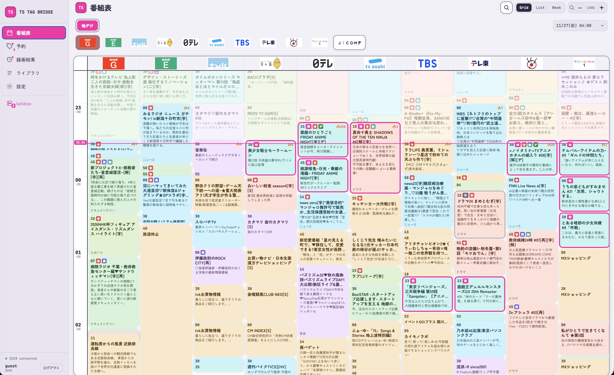
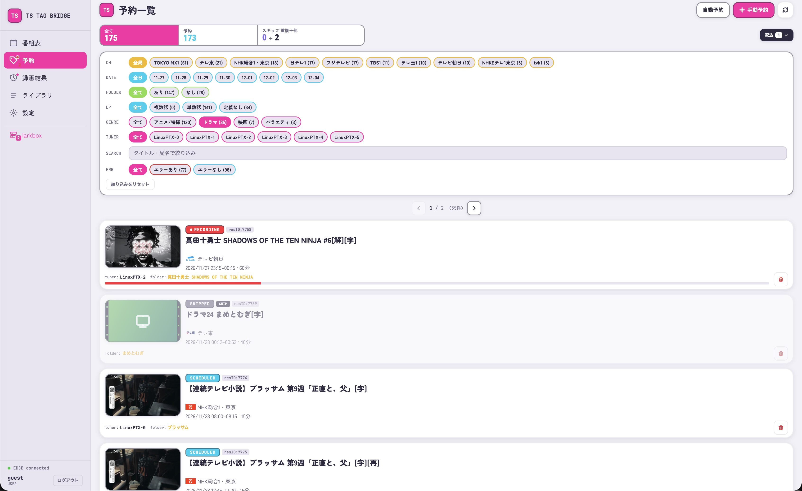
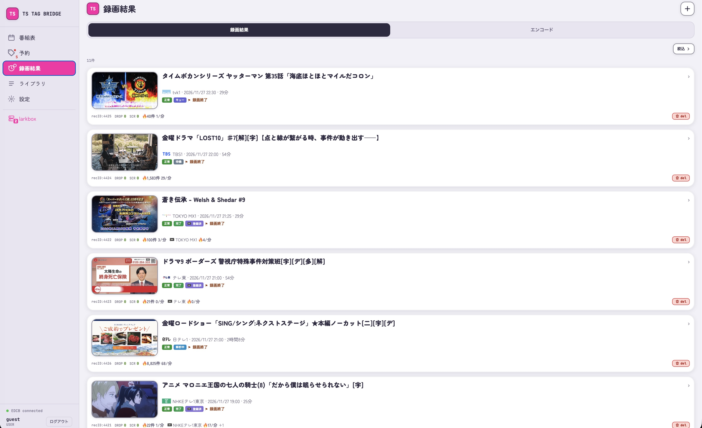
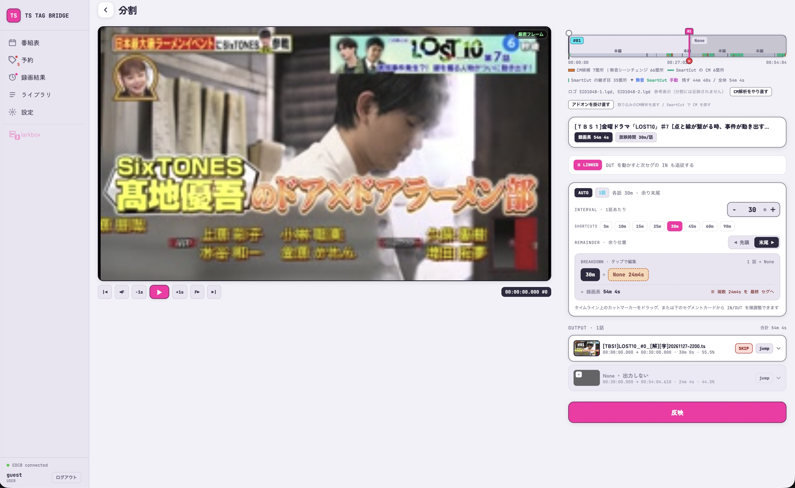
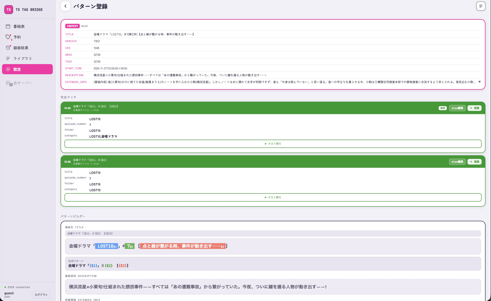
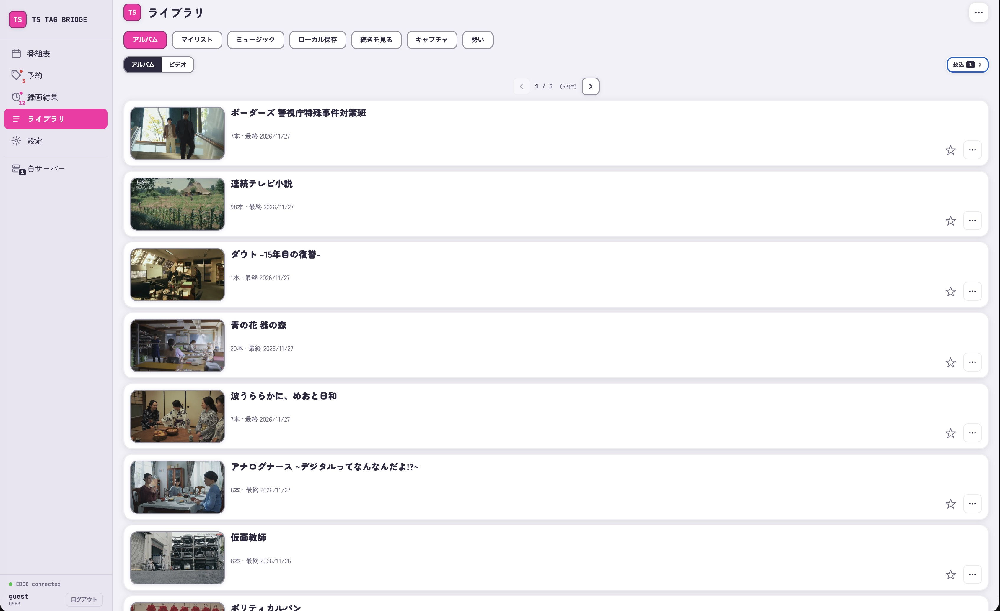

# ts-tag-bridge

日本の地上波・BS/CS の録画環境（[EDCB](https://github.com/xtne6f/EDCB) と [Amatsukaze](https://github.com/nekopanda/Amatsukaze)）の上に乗せて、
番組表・予約・録画後の整理・エンコード・動画ライブラリ・視聴までを受け持つサーバーです。

録画が終わると、番組名から作品名・話数・副題を読み取って整理し、CM の位置を調べてエンコードの順番待ちへ載せます。
出来上がった動画は配信して観られます（字幕・実況コメント・チャプターつき）。
画面（アプリ）は同じリポジトリの `apps/app`（Web 版の Expo）で、このサーバーの API を使います。
サーバーを何台かつなぐと、別の機械で録った物も1つのライブラリに集められます。

ライセンスは [MIT](LICENSE) です。同梱・移植したソフトウェアの著作権表示は [THIRD-PARTY-NOTICES.md](THIRD-PARTY-NOTICES.md) にあります。

---

## できること

| | |
|---|---|
| **番組表・予約** | EDCB の番組表を見て予約する。キーワードでの自動予約、手動の時間予約、予約の一覧と編集 |
| **録画の整理** | 番組名を「パターン」で読み解いて、作品名・話数・副題・置き場所を決める。パターンは API から作って試せる |
| **CM の位置と分割** | ロゴ・無音・シーンの切り替わりから CM を探す。1つの録画に何話も入っている時は話ごとに分ける。結果は API から直せる |
| **エンコード** | 録画が終わったら自動で Amatsukaze の順番待ちへ載せる。進み具合・やり直し・一時停止も API から |
| **ライブラリ** | 作品・話数でまとめる。シークバーのサムネ、チャプター、続きから再生、音楽のアルバム |
| **視聴** | 録画した動画とライブ放送を配信する。ARIB 字幕と実況コメントも渡す |
| **サーバーをつなぐ** | 別の機械で録ってエンコードした物を受け取って1つのライブラリへ。相手の番組表・予約もこちらから触れる |
| **アドオン** | `server/addon/` にファイルを置くだけで、エンコードの方法・通知・番組表の元・パターンの読み方・再生画面のタブ・API の口・表示言語を足せる（[仕様](server/addon/README.md)） |

---

## 中身の置き場

```
scripts/           準備（設定の質問を含む）・起動・停止・自動起動（下の「動かす」）

server/            サーバー（Python。Quart + uvicorn）
  main.py          起動の入口
  boot/            起動の準備（DB接続・待ち受けポート・ログ・常駐処理の立ち上げ）
  requirements.txt Python の依存（pip install -r で入れる）
  config.yml.example 設定の見本（実体の server/config.yml は秘密なのでリポジトリに入らない）
  data_paths.py    データの置き場（config.yml の data_dir）を決める仕組み
  api/             HTTP の口
  workers/         録画を見張って、整理・CM 解析・エンコードへ回す常駐処理
  logic/           処理の本体（CM カット・分割・エンコードの段取り・アドオンの実行など）
  db/              SQLite（番組と録画・動画・利用者）
  media/           映像・音声・字幕を読む部品
  clients/         EDCB・Amatsukaze・ほかのサーバーへの呼び出し
  packages/        番組名を読み解く text_parser
  addon/           アドオンの置き場（書き方の説明だけ入っている）
  static/          サーバーが配るファイル（ライブ画面のライブラリなど）
  thirdparty/      外部ツールの置き場（install.sh で入れる。リポジトリには入っていない）
    read_tsprogram/  TS から番組情報・字幕・局ロゴ・TOT・パケットの異常を読む部品
                     （https://github.com/noshiket/read_tsprogram。install.sh が固定の版を git のまま入れる）

apps/              アプリの画面（Expo Router。Web 版をここでビルドする）
  app/             画面のソース（src・native の modules・assets・e2e など）。ビルド生成物（dist・node_modules・ios・android）はリポジトリに入らない

packages/          画面が使う共通ロジック
  core/            録画・予約・再生などのサーバーAPIの読み書きと、画面の共通部品
    src/           実装（TypeScript。apps が @tstag/core で直接読む）
    test/          単体テスト（vitest）

```

---

## 動かす

### 要るもの

- Linux（x86_64 で動かしています。自動起動には systemd）。Python 3.12
- 別に動いている EDCB と Amatsukaze（HTTP で届くこと）
- 録画の TS とエンコードした動画を置くディスクが、このサーバーから読み書きできること

### 準備

```bash
scripts/setup.sh            # Python の環境・TS を読む部品（read_tsprogram）・外部ツール（FFmpeg・tsreadex など）・server/config.yml の用意・Web 版のビルド（node か Docker があれば）
scripts/setup.sh --akebi    # HTTPS にする Akebi も入れる
```

途中で、足りない所を聞きます（空で Enter なら勧める値。答えは `server/config.yml` に書き、コメントは残します）。

| 質問 | 内容 |
|---|---|
| エンコーダー | GPU を見て勧めます（Intel → QSVEncC・NVIDIA → NVEncC・AMD → VCEEncC・Rockchip → rkmppenc・無ければ FFmpeg）。選んだ物だけ入れます |
| EDCB・Amatsukaze の場所 | 既定は `http://localhost:5510`・`http://localhost:32769`。その場でつながるかを見ます。docker で別のパスに見せている時は、パスの読み替えも聞きます |
| 置き場 | 作業の置き場と、エンコードした動画の置き場（いくつでも）。書き込めるか・空きを見せ、無ければ作るかを聞きます |
| しょぼいカレンダーへ伝える連絡先 | 番組の情報を問い合わせる時の User-Agent に入れる連絡先（URL かメールアドレス）。[bot についての決まり](https://docs.cal.syoboi.jp/rule/bot/) で求められています。空ならこのアプリの案内のページ（`https://github.com/noshiket/ts-tag-bridge`） |

何度流しても大丈夫です（済んでいる所は飛ばし、質問は今の値を既定にします）。質問せずに渡すこともできます
（`--encoder NVEncC --edcb-url URL --amatsukaze-url URL --tmp DIR --encode-dir DIR --shoboi-contact URL`）。
外部ツールだけ入れ直す時は `server/thirdparty/install.sh`（`--status` で入っている物を見る）。
ほかの項目は、起動した後にアプリの設定の画面からも直せます。

### 起動・停止

```bash
scripts/server.sh start     # 起動（DB を控えてから）
scripts/server.sh stop      # 止める（止まり切るまで待つ）
scripts/server.sh restart   # 起動し直す
scripts/server.sh status    # 動いているか・開く URL
scripts/server.sh log       # ログを流して見る
```

電源を入れた時に起動し、落ちたら立て直すようにするなら（systemd の利用者のサービス。root は要りません）:

```bash
scripts/install-service.sh            # 入れて起動する
sudo loginctl enable-linger $USER     # ログインしていない時も動かす（一度だけ）
scripts/install-service.sh --remove   # 外す
```

入れた後も `scripts/server.sh` で同じように操作できます（systemd に頼みます）。

最初に登録した人が管理者になります。2人目からは管理者が承認するまで使えません。

主な設定:

| 項目 | 内容 |
|---|---|
| `port` / `https` | 待ち受けるポート。`https.enabled` で Akebi を前に置いて HTTPS / HTTP2 にする（本体は `backend_port` で待つ） |
| `jwt_secret` | ログインの署名の鍵。`install.sh` が空なら作る |
| `edcb_servers` / `amatsukaze_servers` | EDCB と Amatsukaze の場所。何台でも書ける。コンテナの中から見たパスとの読み替え（`volumes`）もここ |
| `tmp_base` / `encode_dir_list` / `output_path` | 作業の置き場、エンコードした物の置き場（ディスクを分けられる）、ファイル名の決め方 |
| `data_dir` | データベース・パターン・サムネ・アドオンの設定の置き場。空なら `server/data` |
| `streaming.encoder` | 配信の変換とエンコードのアドオンが使うエンコーダー（QSVEncC・NVEncC・VCEEncC・rkmppenc・FFmpeg）。`setup.sh` が聞いて書く |
| `web_dir` | アプリの Web 版の置き場（下の「画面」）。空なら `apps/app/dist` |
| `log_debug` / `log_file` / `log_file_path` | 細かいログを出すか、ファイルにも書くか、その場所。再起動なしで変わる |
| `federation` | サーバーをつなぐ設定（下の「サーバーをつなぐ」） |
| `shoboi_contact` | しょぼいカレンダーへ伝える連絡先（User-Agent に入れる）。`setup.sh` が聞いて書く。空ならこのアプリの案内のページ |

全部の項目と説明は [`server/config.yml.example`](server/config.yml.example) にあります。

### 画面

画面のアプリ（Web 版の Expo アプリ）のソースは `apps/app` にあります。サーバーはそこにビルドした Web 版を `/` で配ります（置き場は `config.yml` の `web_dir`、既定は `apps/app/dist`）。

Web 版は `scripts/setup.sh` が準備の最後で自動ビルドします（後から更新する時は `scripts/build-web.sh` だけでビルドできます。ホストに Node が無ければ Docker の `node:20` を使い、依存が無ければ `npm ci` / `npm install` します）。`dist` が無いと `/` は 503（Web 版がまだ書き出されていません）を返しますが、API が動きます。

**画面の例**

| | |
|---|---|
|  | 番組表。予約状況を示し、そこから予約できる |
|  | 予約の一覧。自動予約のキーワードと個別の予約 |
|  | 録画の一覧。整理・CM解析・エンコードの状態 |
|  | 分割。1本の録画を話数や CM で分ける |
|  | パターン登録。番組名から作品名・話数・副題を読む |
|  | ライブラリ。作品・話数でまとまった動画 |

---

## サーバーをつなぐ

録る機械とライブラリを置く機械を分けたり、何台かの録画を1か所に集めたりできます。
両方の `config.yml` の `federation` に、同じ合言葉（`fed_token`）を入れます。

- **録った物を送る**: 送る側に `library_peer`（送り先）を書くと、エンコードが終わった物が送り先のライブラリへ入ります
- **相手を触る**: `remote_nodes` に書いた相手の番組表・予約・自動予約を、こちらから見て操作できます
- **パターンをそろえる**: 番組名の読み方（パターン）は、どちらで直しても相手へ写ります

合言葉ではサーバーの設定の変更や再起動はできません。そうした操作は、それぞれのサーバーへログインして行います。

---

## アドオン

`server/addon/` に `.py`（または `<名前>/main.py`）を置くと、再起動なしで読み込まれます。
書き方は [server/addon/README.md](server/addon/README.md) にあります。

---

## 開発者向け

### API

画面（アプリ）が使う口は、ほかのプログラムからも呼べます。口の一覧・呼び方・誰が呼べるかは、起動した後に
アプリの 設定 → アプリ → 開発者向け → API の一覧 で読めます（動いているサーバーから作るので、アドオンが足した口も出ます）。

### コードの決まり

- **ファイルは小さく**: 1 ファイル 200 行くらいまで。役割ごとにフォルダを分け、名前で中身が分かるようにする。
- **口には説明書き**: API の関数には docstring を書く（1 行目が口の一覧の見出しになる）。
- **コメントは「なぜ」**: 何をしているかより、なぜそうしているか（過去に何が起きたか）を書く。日本語で書く。
- **実在の名前を書かない**: 例やコメントに、実在のサービス名・番組名・局名・サーバー名・個人の情報・手元のパスを書かない。
  架空の名前にする（局の照合表や SID の表など、動きに要る物は除く）。
- **ライセンス**: GPL のコードはこのリポジトリに入れない。別のリポジトリにして、`install.sh` で入れて別のプロセスで呼ぶ。
  外部ツールの版は `install.sh` で固定する（サーバーごとに版が違うと、片方だけ失敗する）。
- **アドオンは単体で**: アドオンは1つずつ入れる・外す前提なので、似ていても共通の部品にまとめない。
- **一時ファイルは片付ける**: 作った一時ファイル・フォルダは、処理の後に消す（失敗した時も消えるようにする）。

---

## ライセンスについて

本体は MIT です。そのために、GPL のコード（CM カットの無音・シーン検出の移植 `chapterexe_py`）は
このリポジトリに入れず、`install.sh` で利用者の環境へ入れ、別のプロセスとして呼ぶだけにしています。

同梱しているライブラリ、移植したコード、実行時に取ってくるツール、Python の依存のライセンスは
[THIRD-PARTY-NOTICES.md](THIRD-PARTY-NOTICES.md) にまとめてあります。

番組の情報は、しょぼいカレンダー・Wikipedia・実況のサービスなど外部のサービスから取ります。
それぞれの利用規約に従ってください。取ったデータを配り直すことは想定していません。

---

## 謝辞

このプロジェクトは、日本の録画環境を支えてきたソフトウェアを読み、移植し、呼び出すことで成り立っています。
作者の方々に感謝します。

- **録画・エンコード・CM 検出**: [EDCB](https://github.com/xtne6f/EDCB)、[Amatsukaze](https://github.com/nekopanda/Amatsukaze)（nekopanda 氏）、
  [join_logo_scp](https://github.com/yobibi/join_logo_scp)（yobibi 氏）、[chapter_exe](https://github.com/rigaya/chapter_exe)・
  [QSVEnc](https://github.com/rigaya/QSVEnc)・[delogo](https://github.com/rigaya/delogo)（rigaya 氏）、
  [透過性ロゴフィルタ](https://github.com/makiuchi-d/delogo-aviutl)（MakKi 氏）、
  [tsreadex](https://github.com/xtne6f/tsreadex)・[psisiarc](https://github.com/xtne6f/psisiarc)・[psisimux](https://github.com/xtne6f/psisimux)（xtne6f 氏）、
  [FFmpeg](https://ffmpeg.org/)
- **視聴**: [KonomiTV](https://github.com/tsukumijima/KonomiTV)・[Akebi](https://github.com/tsukumijima/Akebi)（tsukumijima 氏。EDCB の制御・実況・サムネ・ライブ配信の部分は `server/media/tsukujima/` として取り込ませてもらっています）、
  [biim](https://github.com/monyone/biim)・[aribb24.js](https://github.com/monyone/aribb24.js)（monyone 氏）、
  [mpegts.js](https://github.com/xqq/mpegts.js)（xqq 氏）、
  [Danmaku](https://github.com/weizhenye/Danmaku)（Zhenye Wei 氏）、[lbpcascade_animeface](https://github.com/nagadomi/lbpcascade_animeface)（nagadomi 氏）
- **土台**: [Quart](https://github.com/pallets/quart)、[uvicorn](https://www.uvicorn.org/)、[PyAV](https://github.com/PyAV-Org/PyAV)、
  [NumPy](https://numpy.org/)、[Numba](https://numba.pydata.org/)、[OpenCV](https://opencv.org/)、[ariblib](https://github.com/youzaka/ariblib)（youzaka 氏）

移植したコードの原典・作者・ライセンスは、各ファイルの冒頭と [THIRD-PARTY-NOTICES.md](THIRD-PARTY-NOTICES.md) に書いてあります。
誤りや漏れがあれば教えてください。
